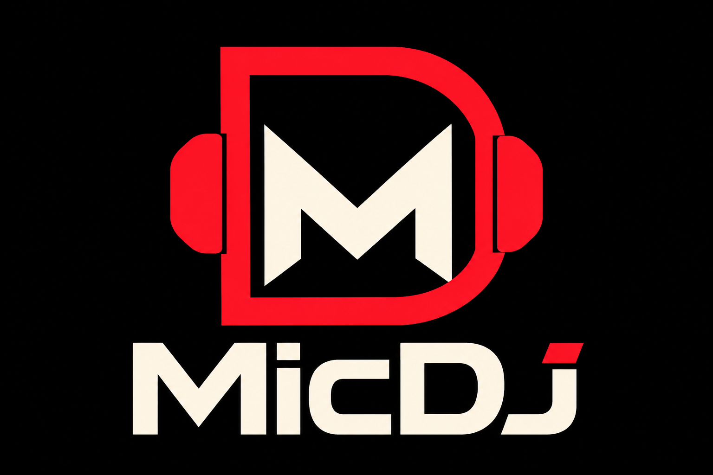

# MicDJ



A mixer for Windows 10/11: combine your microphone and a selected WAV file into one input.

> [!IMPORTANT]
> Requires [VB-CABLE](https://vb-audio.com/Cable/) installed.

## Keyboard shortcuts

Open **Key mappings** from the main window. Search for a sound by name, select it,
click the shortcut field, press a function key or a Ctrl/Alt combination, then click
**Assign**. The scrollable list supports editing and clearing assignments.
**Save mappings** applies and remembers changes; **Cancel** discards them.

Shortcuts play sounds while the mixer is running and the main MicDJ window is focused.
They are inactive while editing mappings or using another application.

## Build

Requires the [.NET 10 SDK](https://dotnet.microsoft.com/download/dotnet/10.0).

```powershell
dotnet build MicDJ.sln -c Release
dotnet run --project src/MicDJ
dotnet run --project tests/MicDJ.Checks -c Release
```
